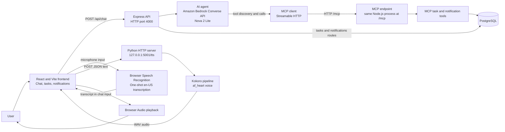

# Voxara

Voxara is a conversational task-management web app. Users can manage tasks with text or one-shot browser speech recognition, while an AI agent uses Model Context Protocol (MCP) tools to read and update PostgreSQL data. Replies can be spoken with a local Kokoro text-to-speech (TTS) service.

<h2 align="center">Tech Stack</h2>

<div align="center">
  <p><strong>Frontend</strong></p>
  <p>
    <a href="https://react.dev/"></a>
    <a href="https://vite.dev/"></a>
    <a href="https://developer.mozilla.org/en-US/docs/Web/JavaScript"></a>
    <a href="https://tailwindcss.com/"></a>
  </p>

  <p><strong>Backend</strong></p>
  <p>
    <a href="https://nodejs.org/"></a>
    <a href="https://expressjs.com/"></a>
  </p>

  <p><strong>AI &amp; Tools</strong></p>
  <p>
    <a href="https://aws.amazon.com/bedrock/"></a>
    <a href="https://modelcontextprotocol.io/"></a>
  </p>

  <p><strong>Database</strong></p>
  <p>
    <a href="https://www.postgresql.org/"></a>
  </p>

  <p><strong>Voice</strong></p>
  <p>
    <a href="https://www.python.org/"></a>
    <a href="https://github.com/hexgrad/kokoro"></a>
  </p>
</div>

The frontend also uses Axios for HTTP requests. The AI agent uses the Amazon Bedrock Converse API with Nova 2 Lite; MCP uses Streamable HTTP and Zod-validated tools; PostgreSQL access uses `pg`; and TTS uses `soundfile` with Python's standard-library HTTP server. Browser Speech Recognition and `Audio` APIs provide voice input and playback. `groq-sdk` is declared in the backend dependencies but is not used by the current AI request path.

The project was built for the Amazon Developer Hackathon Alexa+ track as a web-based assistant. The current implementation uses Amazon Bedrock for AI inference; it does not connect to Alexa or require an Alexa device.

## Key features

- Ask the assistant in natural language to list, find, create, update, complete, or delete tasks.
- Ask for task lists filtered by status, priority, or common dates; date interpretation and filtering are basic.
- Create, view, and complete tasks in the React task dashboard.
- View unread notifications and mark them as read.
- Check pending tasks with configured reminder times and create reminder notifications once per minute.
- Discover and invoke task and notification operations through MCP tools.
- Use browser speech recognition to put dictated text into the chat input.
- Generate spoken responses with Kokoro through a local Python HTTP service.
- Stop current or pending TTS playback, including when activating the microphone.
- See chat, listening, thinking, and speaking states, notification updates, and task status cards.

## Demo

No screenshot or hosted demo URL is included in the repository. The root contains generated WAV test audio files, but these are not application screenshots or a hosted demo.

## Architecture



The Express API and MCP endpoint are hosted by one Node.js server. The AI agent obtains the registered MCP tool definitions and uses Bedrock to choose when to call them. MCP tools perform the database operations; regular task and notification API routes also query PostgreSQL directly. The browser talks to the separate TTS service only for speech generation.

## Project structure

```text
Voxara/
├── backend/
│   ├── package.json
│   ├── .env                         # Local configuration; do not commit
│   ├── src/
│   │   ├── agent.js                 # Bedrock agent and MCP client
│   │   ├── api.js                   # Chat, task, and notification API
│   │   ├── db.js                    # PostgreSQL connection pool
│   │   ├── db-test.js               # Database connectivity check
│   │   ├── reminder.js              # Reminder schema adjustment and polling
│   │   ├── server.js                # Express and MCP server/tool definitions
│   │   └── test-bedrock.js          # Bedrock connectivity test script
│   └── ui/
│       ├── index.html               # MCP Apps task interface
│       ├── main.js
│       └── vite.config.js
├── frontend/
│   ├── package.json
│   ├── .env                         # Local frontend configuration; do not commit
│   └── src/
│       ├── App.jsx                  # Chat and voice interface
│       ├── component/TaskDashboard.jsx
│       └── api/                     # Axios clients for backend routes
├── kokoro_server.py                 # Local Kokoro HTTP TTS server
├── test_kokoro.py                   # Local Kokoro audio-generation test
├── LICENSE
└── README.md
```

`backend/ui/dist/index.html` is generated by `npm run build:ui`. The MCP server reads this file during startup, so build the embedded MCP App before starting the backend when setting up a clean checkout.

## Prerequisites

- Node.js `^20.19.0` or `>=22.12.0` and npm. These versions satisfy the Vite 8 engine requirement in the lockfiles.
- PostgreSQL, available locally or remotely. The repository does not specify a minimum PostgreSQL version.
- An AWS account and AWS credentials with permission to invoke the configured Amazon Bedrock model in `ap-south-1`.
- Python 3.12 recommended for the Kokoro service. The repository does not include a Python dependency manifest.
- A modern browser with microphone access and `SpeechRecognition` or `webkitSpeechRecognition` support for voice input. Text chat does not require speech recognition.

## Installation and setup

The commands below use Windows PowerShell. Start each service in its own terminal and run commands from the indicated directory.

### 1. Install and prepare PostgreSQL

Create a database named `voxara` using your PostgreSQL installation. For example, if the PostgreSQL command-line tools are on `PATH`:

```powershell
createdb voxara
psql -d voxara
```

At the `psql` prompt, initialize the schema used by the current backend:

```sql
CREATE TABLE tasks (
    id SERIAL PRIMARY KEY,
    user_id VARCHAR(100) NOT NULL,
    title VARCHAR(255) NOT NULL,
    priority VARCHAR(20) NOT NULL DEFAULT 'medium'
        CHECK (priority IN ('low', 'medium', 'high')),
    status VARCHAR(20) NOT NULL DEFAULT 'pending',
    due_date TIMESTAMP NULL,
    remind_at TIMESTAMP NULL,
    idempotency_key UUID NULL,
    created_at TIMESTAMP NOT NULL DEFAULT CURRENT_TIMESTAMP,
    CONSTRAINT tasks_user_id_idempotency_key_key
        UNIQUE (user_id, idempotency_key)
);

CREATE TABLE notifications (
    id SERIAL PRIMARY KEY,
    user_id VARCHAR(100) NOT NULL,
    task_id INTEGER REFERENCES tasks(id) ON DELETE CASCADE,
    message TEXT NOT NULL,
    type VARCHAR(50) NOT NULL,
    is_read BOOLEAN NOT NULL DEFAULT FALSE,
    created_at TIMESTAMP NOT NULL DEFAULT CURRENT_TIMESTAMP
);
```

The repository does not include a migration or database initialization file. The `reminder.js` service ensures the `remind_at` column exists and, on its first check after startup, copies `due_date` into `remind_at` for rows where `remind_at` is null. That backfill is not repeated for tasks created later in the same process; supply `remindAt` when a newly created task needs a reminder. The unique constraint on `(user_id, idempotency_key)` supports idempotent task creation.

The current app uses the fixed user ID `user123`; it does not implement user registration or authentication.

### 2. Configure environment variables

Create `backend/.env` and `frontend/.env` as described in [Environment configuration](#environment-configuration). Use your own database settings and AWS credential configuration. Do not put real credentials in the repository.

The backend uses the AWS SDK's standard credential provider chain (for example, an AWS CLI profile, an assigned role, or credential environment variables). The Bedrock region and model are set in source code; they are not read from environment variables.

### 3. Install backend dependencies and build the MCP App

From the repository root:

```powershell
cd backend
npm ci
npm run build:ui
```

The build emits `backend/ui/dist/index.html`, which the MCP server loads when it starts.

### 4. Install frontend dependencies

In a separate terminal, from the repository root:

```powershell
cd frontend
npm ci
```

### 5. Create the Python environment and install TTS dependencies

From the repository root:

```powershell
py -3.12 -m venv kokoro-py312
.\kokoro-py312\Scripts\Activate.ps1
python -m pip install --upgrade pip
python -m pip install kokoro soundfile
```

The Python service imports `KPipeline` from `kokoro` and `soundfile`. There is no `requirements.txt` or `pyproject.toml`; the install command lists the direct imports and lets pip resolve their dependencies.

## Environment configuration

No `.env.example` file is provided. The values below are the variables read by the application; placeholders are examples only.

### `backend/.env`

| Variable | Required? | Purpose |
| --- | --- | --- |
| `DB_USER` | Yes | PostgreSQL user |
| `DB_HOST` | Yes | PostgreSQL host |
| `DB_NAME` | Yes | Database name, normally `voxara` for the setup above |
| `DB_PASSWORD` | Yes | Password for the PostgreSQL user |
| `DB_PORT` | Yes | PostgreSQL port, normally `5432` |
| `PORT` | No | HTTP port for the Express and MCP server; defaults to `4000` |
| `MCP_URL` | No | MCP URL used by the agent; defaults to `http://localhost:4000/mcp` |
| `NODE_ENV` | No | When set to `production`, configures the PostgreSQL pool to use SSL with `rejectUnauthorized: false` |

Example backend configuration:

```env
DB_USER=your_local_postgres_user
DB_HOST=localhost
DB_NAME=voxara
DB_PASSWORD=your_local_postgres_password
DB_PORT=5432
PORT=4000
MCP_URL=http://localhost:4000/mcp
```

The Bedrock client uses region `ap-south-1` and model `global.amazon.nova-2-lite-v1:0`, both set in `backend/src/agent.js`. Configure AWS credentials using the AWS SDK credential provider chain. No `GROQ_API_KEY` is used by the current agent.

### `frontend/.env`

| Variable | Required? | Purpose |
| --- | --- | --- |
| `VITE_API_URL` | Yes for local setup | Base URL used by Axios for backend API requests |

Example:

```env
VITE_API_URL=http://localhost:4000
```

The TTS endpoint is currently hard-coded in the frontend as `http://127.0.0.1:5001/tts`. The Python server binds to `127.0.0.1:5001`; neither setting is configurable through environment variables.

## Running the application

### Start the backend

In a terminal with the current directory set to `backend`:

```powershell
npm start
```

For automatic restarts during backend development:

```powershell
npm run dev
```

The server starts the Express API and MCP endpoint on port `4000` by default. Set `PORT` to change the port and update `VITE_API_URL` and `MCP_URL` to match. The server checks reminders shortly after startup and then once per minute.

### Start the frontend

In a separate terminal with the current directory set to `frontend`:

```powershell
npm run dev
```

Open the Vite URL shown in the terminal, normally `http://localhost:5173`. The backend's CORS configuration allows this origin. Use `localhost` rather than `127.0.0.1` for the development frontend because the TTS service also allows the `http://localhost:5173` origin.

### Start the Kokoro TTS server

In a separate terminal from the repository root, activate the Python environment created above and run:

```powershell
.\kokoro-py312\Scripts\Activate.ps1
python kokoro_server.py
```

The server listens at `http://127.0.0.1:5001`. Keep it running for spoken responses; text chat and task management do not require it.

### Try it

Use text chat or the microphone and try requests such as:

- `Show my pending tasks`
- `Create a high-priority task to prepare the demo for tomorrow`
- `Find the task about the demo`
- `Mark the demo task as complete`
- `Check my reminders`

The microphone transcription is placed into the chat field; press **Send** to submit it. The assistant's text response is displayed even if the TTS service is unavailable.

## API documentation

The following application endpoints are implemented by the Express server. Replace `http://localhost:4000` if `PORT` is changed.

| Method | Path | Purpose | Request / response details |
| --- | --- | --- | --- |
| `POST` | `/api/chat` | Process an assistant message | JSON body: `message` (required), optional `conversationHistory` array and `idempotencyKey`. Responds with `response`, and may include `tasks` and `notifications`. |
| `GET` | `/api/tasks` | List tasks for `user123` | Responds with `{ "tasks": [...] }`. |
| `POST` | `/api/tasks` | Create a task for `user123` | JSON body: `title` (required), optional `priority` (defaults to `medium`) and `due_date`. Responds `201` with `{ "task": ... }`. |
| `PATCH` | `/api/tasks/:id/complete` | Mark a task completed | Responds with `{ "task": ... }`, or `404` if the task is not found for the fixed user. |
| `GET` | `/api/notifications` | List unread notifications for `user123` | Responds with `{ "notifications": [...] }`. |
| `PATCH` | `/api/notifications/:id/read` | Mark a notification read | Responds with `{ "success": true }` on a successful query. |

`POST /api/chat` can respond with `400` when `message` is missing and `500` if processing fails. The frontend retries network failures and server errors up to three attempts. The chat idempotency key is reused when the same failed message is retried.

### MCP transport

The backend exposes the MCP Streamable HTTP transport at `/mcp`, by default:

```text
http://localhost:4000/mcp
```

The agent connects to this endpoint to discover and call tools. The MCP server also serves an embedded task UI resource at `ui://voxara/tasks.html`; its generated bundle must exist before the backend starts.

## MCP tools

All tools are registered in `backend/src/server.js`. The agent supplies the fixed `userId` value `user123`.

| Tool | Input parameters | Purpose |
| --- | --- | --- |
| `get_tasks` | `userId: string` | Retrieve the user's tasks, newest first. |
| `get_notifications` | `userId: string` | Retrieve unread notifications for the user. |
| `find_task` | `userId: string`, `query: string` | Search task titles by substring or PostgreSQL text search. |
| `create_task` | `userId: string`, `title: string`, `priority: "low" \| "medium" \| "high"`, optional nullable `dueDate: string`, optional nullable `remindAt: string`, optional UUID `idempotencyKey: string` | Create a pending task. |
| `update_task` | `userId: string`, `taskId: number`, optional `title: string`, optional `priority: "low" \| "medium" \| "high"`, optional nullable `dueDate: string` | Update a task's title, priority, and/or due date. |
| `complete_task` | `userId: string`, `taskId: number` | Mark a task completed. |
| `delete_task` | `userId: string`, `taskId: number` | Delete one task. |
| `delete_all_tasks` | `userId: string` | Delete every task belonging to the user. |

`get_tasks` is also registered as an MCP App tool and is linked to the embedded task UI. That UI can list, create, and complete tasks through MCP tools.

## Voice system

### Voice input

The microphone button uses the browser's `SpeechRecognition` or `webkitSpeechRecognition` implementation. Recognition is configured for `en-US`, with `continuous` and `interimResults` both disabled. When recognition returns a transcript, Voxara places it in the text input; the user submits it with **Send**.

Activating the microphone calls `stopSpeaking()` before checking or starting speech recognition. This stops active audio and invalidates a pending TTS response so that it will not start playing later. It does not cancel an AI request already being processed. If the browser lacks the Speech Recognition API, the interface displays an alert. Microphone access also depends on browser permission and a supported browser context.

### Spoken responses

After an assistant response, the frontend sends cleaned response text to:

```http
POST http://127.0.0.1:5001/tts
Content-Type: application/json

{"text":"Response text"}
```

The Python server runs `KPipeline(lang_code="a")` with voice `af_heart`, writes generated audio at 24 kHz, and returns a WAV file (`Content-Type: audio/wav`). The browser plays that file using an audio object. The server currently writes and returns only the first yielded audio chunk.

While playback is active, the interface shows a speaking state and a **Stop** control. Stopping pauses playback and prevents an in-flight TTS result from playing. New notifications discovered by the frontend's 30-second poll are also sent to TTS.

Voice is request-and-response, not continuous conversation. There is no wake-word detection, automatic barge-in detection while speech is playing, or full-duplex audio. The microphone must be activated for each utterance.

## Ports and local service dependencies

| Service | Default address | Used for |
| --- | --- | --- |
| Vite frontend | `http://localhost:5173` | React development UI |
| Express and MCP | `http://localhost:4000` | API routes and `/mcp` transport |
| Kokoro TTS | `http://127.0.0.1:5001` | `POST /tts` WAV generation |
| PostgreSQL | `localhost:5432` | Task and notification persistence |
| Amazon Bedrock | Region `ap-south-1` | AI inference using the configured Nova 2 Lite model |

The backend CORS allowlist includes the local Vite origin `http://localhost:5173`. The Python TTS handler also allows that exact origin.

## Troubleshooting

### PostgreSQL connection errors

- Confirm PostgreSQL is running and the database exists.
- Check `DB_USER`, `DB_HOST`, `DB_NAME`, `DB_PASSWORD`, and `DB_PORT` in `backend/.env`.
- Confirm the tables and the unique `(user_id, idempotency_key)` constraint exist. The project does not ship a migration script.
- Start the backend from `backend/` so dotenv can load `backend/.env`.

### Missing environment settings or frontend API failures

- Ensure both local `.env` files exist and `VITE_API_URL` is set to the backend base URL.
- Restart Vite after changing its environment file; Vite reads variables at startup.
- Use `http://localhost:5173` and `http://localhost:4000` for local development. The backend and TTS CORS rules allow the localhost frontend origin.

### Bedrock access or model errors

- Configure AWS credentials through the AWS SDK credential provider chain.
- Confirm the credentials can invoke `global.amazon.nova-2-lite-v1:0` in `ap-south-1`, and that Bedrock model access is enabled for the account.
- Check backend logs for Bedrock access-denied, throttling, or other errors. The model ID and region are currently constants in source, not environment settings.

### MCP connection or tool errors

- Confirm the backend is listening on the expected `PORT` and `MCP_URL` points to its `/mcp` route.
- Run `npm run build:ui` from `backend/` before startup if the server reports it cannot load `backend/ui/dist/index.html`.
- Check backend logs for MCP connection, database, or tool error messages.

### Microphone does not work

- Grant microphone permission to the browser.
- Use a browser that implements `SpeechRecognition` or `webkitSpeechRecognition`.
- Check browser console errors. Speech input is a single transcription at a time and does not auto-send.

### Kokoro setup or playback problems

- Activate the Python virtual environment and confirm `kokoro` and `soundfile` are installed in it.
- Start `python kokoro_server.py` and leave it running at `127.0.0.1:5001`.
- Confirm the frontend is served from `http://localhost:5173`; the TTS handler only allows that CORS origin.
- Check Python terminal output for model or audio-generation errors and the browser console for fetch or playback errors.
- If the browser blocks playback, interact with the page and try again. Text chat remains usable without TTS.

## Current limitations and future work

Implemented behavior and unimplemented capabilities are distinct:

- **Current:** the app uses one fixed user ID (`user123`) and has no authentication or per-user sign-in.
- **Current:** speech recognition is one-shot, and TTS is generated by a separate local Python service.
- **Current:** the TTS handler returns only the first Kokoro output chunk for a request.
- **Current:** date filtering is rudimentary and does not provide robust timezone-aware matching.
- **Not implemented:** continuous real-time conversational voice, wake-word detection, automatic barge-in detection, and full-duplex input/output.
- **Not implemented:** a checked-in database migration/init script, Python dependency lock or manifest, or a full automated application test suite. The repository does include one-off database, Bedrock, and Kokoro test scripts.

Potential future work includes authentication and user isolation, more robust date/time-zone handling, complete multi-chunk TTS output, broader voice interaction, and automated tests. These are suggestions, not claims about existing functionality.

## Contributing

Contributions are welcome. Please keep changes focused, avoid committing local `.env` files or credentials, and document any new setup requirements, endpoints, or MCP tools in this README.

## License

This project is licensed under the MIT License. See [LICENSE](LICENSE) for the license text.
